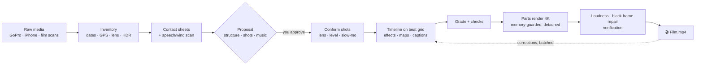

# 🎞️ travel-film

**A Claude Code skill that turns a trip's raw footage into a film you'll actually rewatch.**

Hand Claude a folder of GoPro clips, phone photos and videos, and scans from a film camera. It reviews every
shot, proposes a story in strict chronological order, and, once you approve, edits a calm, music-driven 4K film:
cuts on the beat, windscreen match cuts for the drives, animated route maps, place captions, film-strip
interstitials, triptychs of vertical phone videos and selfie mosaics. It renders on a laptop without running out
of memory and checks the result before calling it done.

The skill was distilled from two real holiday films: a 2.5-minute lake-district edit (GoPro only) and a
9-minute island road trip (GoPro, iPhone and 35 mm film). Every rule in it comes from feedback on those films.

---

## How it works



**Stage 1: review.** Nothing renders. Claude inventories the media, reads contact sheets of every clip, finds
speech and wind, detects the GoPro lens mode and colour profile, clusters phone GPS into days and places, and
groups drive clips by camera mounting. It ends with a proposal and a storyboard, then waits for you.

**Stage 2: edit.** You pick the music together. Claude builds a beat grid, plans the timeline in code, conforms
the shots, generates the effects and maps, grades, checks, and renders.

**Corrections come in batches.** Claude collects your notes ("this photo is blurry", "we slept in X, not Y") and
re-renders only when you say the list is complete.

## Ground rules baked in

| Rule | Why |
|---|---|
| Chronology is sacred | People remember a trip as a sequence; a day shot after a night scene reads as a mistake |
| Judge faces, not pixels | A sharp photo with closed eyes or a mid-chew grimace is still a bad photo |
| No dialogue unless asked | Ambience only from seconds with no speech and no wind; music carries the film |
| Calm, not jumpy | Shots last at least a bar; dissolves only between places and days |
| Music with character | Generic "travel vlog" tracks sound auto-generated; search by concrete genre and era |
| Never delete, never surprise | Every render is kept and new versions get new names |
| Protect the machine | A single 4K render once filled 32 GB of RAM and shut the laptop down |

## Tech stack

| Layer | Tool | Role |
|---|---|---|
| Agent | [Claude Code](https://claude.com/claude-code) | Runs the workflow, reviews frames visually, writes the plan and compositions |
| Composition and render | **HyperFrames** CLI (`npx hyperframes`, ≥ 0.8) | HTML/GSAP timeline → headless Chrome → MP4; colour grading (`media-treatment`), lint/check, snapshots |
| Animation | GSAP 3 | Prints, mosaics, film strips, map routes, captions |
| Media skills | `/hyperframes`, `/media-use` | Composition rules, music catalogue search, local transcription |
| Music catalogue | HeyGen CLI (`heygen audio sounds list`) | Royalty-free music search by text query (optional) |
| Speech detection | Parakeet TDT 0.6B (MLX) / whisper.cpp | **On-device** transcription to find dialogue-free seconds |
| Video I/O | FFmpeg / ffprobe | Decode, encode, concat, mux, loudnorm (−14 LUFS), freeze-frame repair, black/freeze detection |
| HDR → SDR | macOS `avconvert` | iPhone HLG → SDR 1080p with rotation baked in |
| Photos | macOS `sips`, Pillow | HEIC decode, EXIF orientation (`exif_transpose`) |
| Computer vision | OpenCV, NumPy | Fisheye → rectilinear remap (16-bit), horizon levelling, ECC alignment for match cuts |
| GoPro metadata | GPMF parser (in `lensmodel.py`) | Lens mode (`VFOV`), distortion polynomial (`POLY`/`ZMPL`), GPS |
| Beat grid | librosa, SoundFile | Tempo with a hint, percussive-onset phase alignment, bar-accurate track extension |
| Maps | OpenStreetMap Nominatim | Island/region outline by place name; routes as Catmull-Rom splines through road waypoints |
| Rendering safety | bash, `vm_stat`, `caffeinate`, `setsid` | Sequential parts, memory guard, survives the agent session ending |

Developed on macOS 26 (Apple Silicon, 32 GB), Node 22, Python 3.9+, FFmpeg 9. Linux works for everything except
`avconvert` and `sips`; substitute FFmpeg tone-mapping and `pillow-heif`.

## Scripts

| Script | What it does |
|---|---|
| `inventory.py` | Dates, GPS, rotation, HDR, GoPro lens mode for every file |
| `contact_sheets.py` | One sheet per clip / photo batch for visual review |
| `audio_scan.py` | Speech spans and wind per second (on-device ASR) |
| `lensmodel.py`, `conform_fisheye.py` | Read the GoPro lens polynomial; remap fisheye → rectilinear with handles |
| `conform_linear.py` | Linear clips: levelling, push-in, offset, slow motion, handles |
| `dash_align.py` | Align static car parts across drive clips for invisible match cuts |
| `prep_media.py` | Phone video HDR→SDR, photos and scans upright, `media_meta.json` |
| `beats.py` | Beat grid with tempo hint; extend a track by whole bars |
| `effects.py` | Sub-compositions: Ken Burns, bursts, prints, mosaic, triptych, film strip, finale |
| `fetch_outline.py`, `verify_map.py`, `route_maps.py` | Map outline → check against photo GPS → animated per-day maps |
| `render_parts.sh`, `finalize.sh` | Memory-safe parts render, concat, mux, loudness |
| `repair_black.py`, `verify_render.py` | Replace isolated black frames; detect black/freeze/silence, measure LUFS |

`references/` holds the long-form guidance: review checklist, choosing photos of people, music, effects, maps,
rendering, and a list of lessons that each cost hours.

## Install

```bash
git clone https://github.com/<you>/travel-film ~/Development/travel-film
ln -s ~/Development/travel-film ~/.claude/skills/travel-film
python3 -m venv ~/.venvs/travel-film && ~/.venvs/travel-film/bin/pip install -r ~/Development/travel-film/requirements.txt
export TRAVEL_FILM_PYTHON=~/.venvs/travel-film/bin/python
```

You also need Node with `npx hyperframes`, the HyperFrames skills (`/hyperframes`, `/media-use`) and FFmpeg.
For on-device transcription, run `npx hyperframes models install parakeet`.

Then ask Claude something like *"edit a holiday film from ~/Movies/trip"*.

## Privacy: where your footage goes

All media processing runs locally. **No video, photo or audio file is uploaded to any service by this skill or
the tools it calls.** Audited against HyperFrames CLI 0.8.140 and HeyGen CLI 0.8.1:

| What leaves the machine | Where | Contains media? | Notes |
|---|---|---|---|
| Frames, contact sheets, transcripts, prompts that Claude reads | Anthropic API (Claude Code) | **Yes, stills and text** | This is how Claude "sees" the footage. Training use depends on your plan, see below |
| Usage telemetry | PostHog (HyperFrames) | No | Command names, durations, hardware, error messages with paths redacted, IP dropped. Off: `npx hyperframes telemetry disable` or `HYPERFRAMES_NO_TELEMETRY=1` |
| CLI analytics | HeyGen | No | Off: `heygen config set analytics false` |
| Music search queries | HeyGen API | No | Text such as "60s psychedelic guitar"; tracks are downloaded, nothing is uploaded |
| Place name | OpenStreetMap Nominatim | No | e.g. "Mallorca"; GPS coordinates never leave the machine |
| Fonts, GSAP, registry blocks, model weights | Google Fonts, jsDelivr, GitHub, Hugging Face | No | Downloads only |

Never sent: source videos, full-resolution photos, audio, GPS tracks, rendered films. Transcription runs
on-device (Parakeet MLX or whisper.cpp). HyperFrames' optional cloud features (`capture` vision captions via
OpenRouter/Gemini, HeyGen cloud rendering, `heygen asset upload`) are not used by this workflow.

**Does Anthropic train on what Claude sees?** That depends on the account running Claude Code:

- **Team, Enterprise or API** (commercial terms): inputs and outputs are not used for model training by default.
  Your organisation's admins and retention settings apply, so personal footage on a work account is visible to
  that organisation's data policies.
- **Free, Pro or Max** (consumer terms): training use follows the *"Help improve Claude"* setting in
  claude.ai → Settings → Privacy. Turn it off if you don't want your sessions used.

To keep faces off any API entirely, review contact sheets yourself and give Claude written notes instead of images.
That is slower, and the rest of the workflow still works.

This repository contains no media, GPS data or personal paths. The example map config is fictional.

## License

Private; all rights reserved by the owner.
